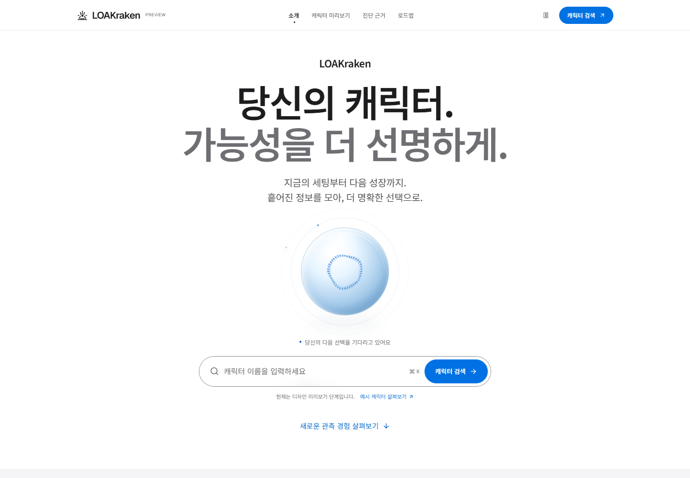
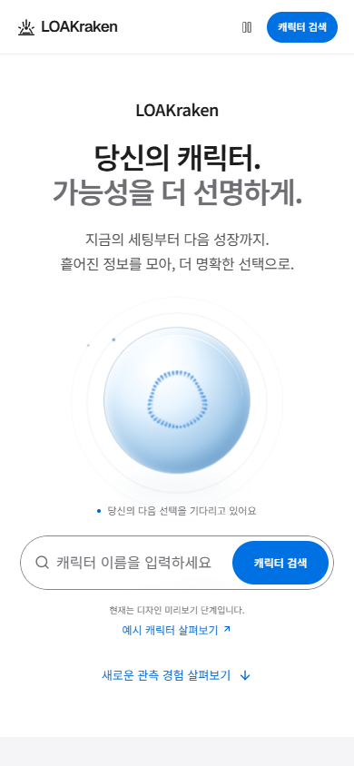

# 프론트 디자인 미리보기

2026-10-04 기준. Apple 스타일의 라이트 화면에 Libraries.dev 오브와 Motion 인터랙션을 적용했다. 랜딩 콕핏 데이터는 예시다. 후속 [캐릭터 API 연결](character-integration.md)을 구현했으며 아래 이미지는 기존 랜딩 디자인 검증 기록이다. 실제 서버 조회와 합성 데이터 검증은 구분한다.

## 화면

## 제품 로드맵 범위

| 영역 | 통합 목표와 참고 서비스 |
|---|---|
| 종합 관측 | 캐릭터·장비·세팅·수집품·원정대·성장 이력 — LOAWA, ILOA, KLOA |
| Kraken Score | 검증된 다차원 점수·랭킹·통계 — LOPEC, ZLOA, LOAWA |
| 성장 추천 | 우선순위·T4 일반/상급/특수 재련·보유 재료·책/숨결·예상 전투력·Gold/DPS — LOPEC, Loavesting, Loatto, LOALAB, IcePeng |
| 시뮬레이션 | 치적·뭉가·음돌·가상 세팅·딜 증가량·젬 교체·팔찌/장신구 연마 — LostBuilds, LOALAB, Loavesting |
| 거래소·계산기 | 시세·재련·보조재료·보석·팔찌·각인·세공·경매·더보기·주간 골드·지옥/나락·교환·제작 수익·패키지 — KLOA, LOAWA, IcePeng, RLoA, LOALAB, Loatto, Loavesting |
| 화면 인식 | 젬·돌 가공 추천과 수동 수정 — Loatto; 레이드 보스·페이즈·기믹 공략 안내 — 사용자 추가 목표 |
| 플레이 관리 | 원정대·일일/주간 숙제·레이드·공격대·골드 — ILOA, RLoA, LoaTodo |
| 일정 | 모험섬·카오스게이트·필드보스·떠돌이 상인 — ILOA, KLOA |
| 정보 | 공략·이벤트·공지·패치노트·커뮤니티 연계 — 로스트아크 인벤 |

개발 기준서 1~9장과 추가 요청을 포함한 9개 영역의 계획이다. 신규 3개를 포함한 13개 서비스의 조사와 반영 결정은 [추가 조사](service-research.md)에 정리했다. 참고 사이트의 모든 세부 기능이나 로그인·계산·예외 흐름을 검증했다는 뜻이 아니다. 종합 조회·진단을 우선 개발하고, 점수·랭킹·성능 예측은 모델·데이터 검증 이후, 성장 이력은 저장 기준 확정 이후 제공한다. 자체 커뮤니티 게시판 운영은 확정하지 않았다.

## 확인한 동작

- `npm run lint`, `npm run build` (TypeScript 포함)
- Edge/Playwright: 검색 빈 값·길이 제한, 한글 이름 이동·새로고침, 포인터·키보드 탭, 근거 펼치기·실제 클립보드 복사, Ctrl+K
- 모션 정지·재생, OS reduced-motion, JavaScript 없는 본문 표시
- 1440/768/390/320px: 가로 넘침 없음, 9개 로드맵 제목·상태 문구 겹침 없음, 브라우저 런타임 오류 없음

로컬 검증 결과는 [인터랙션 결과](previews/interaction-check.json), [로드맵 결과](previews/roadmap-check.json)에 보관한다. 스크린샷과 결과는 해당 날짜의 미리보기 검증 기록이며 API 통합이나 후속 기능의 검증 결과가 아니다.

## 실행

`npm ci` 후 `npm run dev`. 프로덕션 미리보기는 `npm run build` 후 `npm run start -- --hostname 127.0.0.1 --port 3100`.

`thinking-orbs@0.3.2`, `border-beam@1.4.1`, `motion@14.0.0`을 사용하며 각 패키지는 MIT 라이선스다. 디자인·모션 원칙은 루트 `DESIGN.md`를 따른다.
